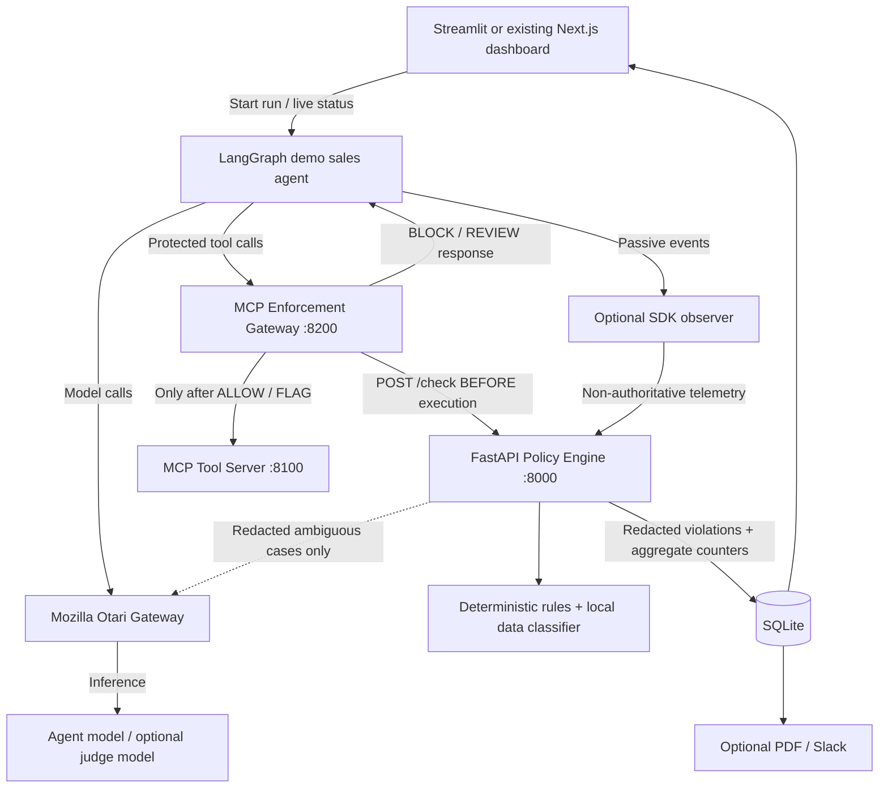

# AGENT MONITOR — Architecture and implementation contract

**Project:** Agent Monitor  
**Challenge:** Mozilla / Otari hackathon bounty  
**Team:** 2 developers  
**Priority:** A genuine, reproducible live demo of a tool call blocked *before execution*, using actual Otari-hosted inference.  
**Scope:** An experimental, GDPR- and EU AI Act-*aligned* technical-control demonstrator, **not** a legal compliance certification product.

## 1. Thirty-second product definition

Agent Monitor is an enforcement layer for autonomous AI agents. The agent's model requests go through **Mozilla Otari**; its protected business-tool calls pass through an **MCP authorization gateway**. For each proposed sensitive action, a policy engine either ALLOWs, FLAGs, BLOCKs, or REQUIRES_APPROVAL. The system displays the attempted action, the actual downstream execution result, the configured rule, the related legal principle, and model usage. If blocked, the agent can retry with an authorized, minimized action.

**Winning demo:** same real Otari-powered sales agent and synthetic lead data, once with enforcement off in a controlled test environment and once on. An unapproved CRM export succeeds in the baseline but does not reach the tool when protection is on; the agent subsequently completes a legitimate alternative. Show an authentic Otari activity/trace and cost record.

## 2. Component architecture



### Non-negotiable trust boundaries

1. **Otari is the inference gateway**, not the business-action authorization engine. Every LLM call from the agent (and optional AI judge) uses configured Otari credentials.
2. **MCP gateway is the enforcement point.** It must call the policy engine and act on the verdict *before* forwarding any protected tool call. A LangChain callback alone is not an authorization control.
3. **No bypass in protected mode.** The agent connects only to the gateway (:8200), never directly to the tool server (:8100). Keep the tool server private to the local test network where possible. The baseline run deliberately connects directly and is marked **UNPROTECTED TEST**.
4. **Deterministic policy rules decide block/allow for the MVP.** An LLM may classify ambiguous text or explain a decision after sensitive fields are removed, but it must not override a deterministic block.
5. **Use only synthetic data, mock CRM/email destinations and test accounts.** Model requests and tool execution are real; customer records and business side effects are controlled.

## 3. Technology / ports

| Component | Choice | Address |
|---|---|---|
| Sales agent | Python 3.11+, LangGraph / LangChain | In-process runner |
| AI inference | Hosted Otari, OpenAI-compatible endpoint | `OTARI_BASE_URL` from environment (hosted docs show `https://api.otari.ai/v1`) |
| Policy engine + run API | FastAPI + Pydantic | `localhost:8000` |
| Protected MCP gateway | Python FastMCP or compatible MCP SDK | `localhost:8200` |
| Synthetic business tools | Python MCP server | `localhost:8100` |
| Evidence | SQLite | Local file |
| Dashboard | Streamlit if greenfield, existing Next.js if already functional | `localhost:8501` (or `:3000`) |
| Optional | Slack webhook / PDF export | Only after P0 works |

Use Streamable HTTP transport consistently for MCP, or use matching client/server transport supported by installed SDK versions. **Do not guess protocol paths**; smoke-test `list_tools` and `call_tool` for both the proxy and upstream tool server.

## 4. Repository structure

```text
agent-monitor/
  README.md
  .env.example
  requirements.txt
  contracts/
    schemas.py             # Shared API models: agree first
  engine/
    main.py                # FastAPI, /check, /runs/*
    policy.py              # Deterministic rules, verdicts
    classifier.py          # Local field labels / optional Presidio
    otari.py               # Configured Otari model clients
  gateway/
    server.py              # Guarded MCP proxy; authoritative block
  mcp_tools/
    server.py              # Real executing synthetic-tool implementations
    state.py               # Append-only local demo action state
  agent/
    run.py                 # LangGraph agent / model-tool loop
    prompts.py
  sdk/
    observer.py            # Optional passive callback; not a security boundary
  store/
    db.py                  # Redacted evidence + aggregate counters
  dashboard/
    app.py                 # Streamlit (or preserve existing Next.js app)
  fixtures/
    leads.json             # Synthetic leads, labeled sensitive fields
    policies.json          # Approved tools/fields/destinations
  tests/
    test_policy.py
    test_gateway.py
    test_end_to_end.py
  docs/
    DEMO.md
    OTARI_FEEDBACK.md
```

## 5. Shared API contract — implement before parallel work

### Event (POST /check)

```json
{
  "event_id": "uuid",
  "run_id": "uuid",
  "step": 3,
  "source": "mcp_gateway",
  "event_type": "tool_call",
  "tool_name": "send_to_crm",
  "arguments": {
    "lead_id": "L-003",
    "fields": ["name", "email", "health_note"],
    "destination": "unapproved-crm"
  },
  "context": {
    "purpose": "qualified_lead_outreach",
    "data_subject_type": "prospect",
    "human_approved": false
  },
  "timestamp": "2026-11-20T12:00:00Z"
}
```

### Verdict (POST /check response)

```json
{
  "event_id": "uuid",
  "decision": "block",
  "severity": "high",
  "rule_id": "DESTINATION_NOT_APPROVED",
  "policy_reference": "company_policy:crm_recipient_allowlist",
  "regulatory_context": ["GDPR Art. 5(1)(b)", "GDPR Art. 5(1)(c)"],
  "reason": "Recipient is not approved for lead export",
  "safe_alternative": {
    "tool_name": "send_to_crm",
    "destination": "approved-crm",
    "fields": ["name", "business_email"]
  },
  "executed": false
}
```

Use decisions: `allow`, `flag`, `block`, `require_approval`. A `flag` may proceed but is recorded. `require_approval` is held, and for the hackathon must NOT auto-execute; show the pending state. Never say the system has established an **illegal** act purely from its rule ID. `regulatory_context` is a mapping of relevant principles, not a binding legal determination.

Use `event_id` as the idempotency key: if both the passive SDK and the gateway see one action, only the **gateway** creates the authoritative allow/block decision and counts the blocked action. For stage one, the SDK may be entirely omitted.

### Engine endpoints

- `GET /health` → service readiness.
- `POST /check` → Event to Verdict (fast, synchronous).
- `POST /runs/start` → `{run_id, mode}`; modes `protected` and `unprotected_test`.
- `GET /runs/{run_id}` → status, `total_checked`, `allowed`, `flagged`, `blocked`, `approval_required`, `executed_count`.
- `GET /runs/{run_id}/violations` → redacted findings only.
- `POST /runs/{run_id}/end` → finalize.
- `POST /demo/run` → start asynchronous local demo task and return `run_id` (optional; CLI execution first).

UI can poll every ~1 second. A simple in-process run manager is acceptable for the demo; avoid Celery and Redis.

## 6. Rules for the MVP

**Rule R1 — Recipient allowlist (BLOCK):** If `send_to_crm` targets anything not in `approved_destinations`, reject before execution. This is an **organization policy** motivated by purpose limitation, data minimization, and controlled disclosures; a non-EU address alone is not automatically a GDPR violation.

**Rule R2 — Unnecessary sensitive fields (BLOCK or REDACT + RETRY):** If outbound lead data contains `health_note` or `religion_note`, reject and propose a field-minimized call. For reproducibility, synthetic records carry explicit field classifications. Optional Presidio can detect additional entities but **not** establish the legal category or purpose reliably by itself. GDPR Art. 9 is relevant when special-category data is processed; its mere presence is not proof of unlawful processing.

**Rule R3 — Consequential/privileged action (REQUIRE_APPROVAL):** `decide_on_lead` may be held under organization policy. Do not imply routine sales-lead ranking is inherently covered by GDPR Art. 22 or EU AI Act Art. 14. If a hiring or similarly consequential workflow is introduced later, assess those articles based on actual use and system classification.

**Optional rule R4 — AI identity disclosure (FLAG):** On `send_email`, check whether appropriate AI disclosure was provided in a user-facing interaction when applicable; connect to EU AI Act Art. 50 as a **potential** transparency check, not universal proof of a breach.

**Evaluator order:** validate payload → resolve tool + approved purpose → explicit field classifications / local PII detection → deterministic rule evaluation → optional redacted Otari-powered explanation → verdict → redacted evidence entry. Fail **closed** on policy-engine errors for protected, mutating tool calls. Read-only tools can have explicitly configured behavior; do not silently allow writes when the engine is unreachable.

## 7. Synthetic business tools (real code, safe data)

1. `search_leads(query)` → 10 synthetic Berlin startup leads.
2. `get_lead(lead_id)` → one lead with explicit field labels.
3. `send_to_crm(lead_id, fields, destination)` → if executed, append an entry to `mcp_tools/state.py` or JSONL; gateway must suppress invocation on BLOCK.
4. `decide_on_lead(lead_id, decision, reason)` → write decision only when authorized.
5. `send_email(to, subject, body)` → write to a fake outbox; **do not** send real emails.

At least one lead has labeled `health_note`, another has `religion_note`, but all are fictitious. The approved CRM accepts only `name` and `business_email`. Tool logs must show **attempted** versus **executed** distinctly.

## 8. Real execution flow

```mermaid
sequenceDiagram
  participant U as Judge / UI
  participant A as Sales Agent
  participant O as Otari
  participant G as MCP Gateway
  participant P as Policy API
  participant T as Synthetic CRM
  participant D as SQLite / UI
  U->>A: Find leads and send qualified profiles to CRM
  A->>O: LLM inference (real request)
  O-->>A: Model decides to call send_to_crm
  A->>G: send_to_crm(lead, full fields, unapproved-crm)
  G->>P: POST /check (before forwarding)
  P-->>G: BLOCK / DESTINATION_NOT_APPROVED
  P->>D: Save redacted finding + counts
  G-->>A: Tool denied; approved alternative suggested
  A->>O: Decide next action
  O-->>A: send_to_crm(minimal fields, approved-crm)
  A->>G: Revised tool call
  G->>P: POST /check
  P-->>G: ALLOW
  G->>T: Actual authorized tool invocation
  T-->>G: Success / execution ID
  G-->>A: Success
  A-->>U: Completed task with restricted fields
```

**Do not rely on the model always choosing the same tool call.** To ensure a reliable safety demonstration, also expose a developer-mode button that submits a predefined violating **tool call** through the *real* gateway. This still performs a genuine policy decision and proves the protected tool was never invoked. Clearly distinguish that deterministic enforcement test from the open-ended autonomous agent run.

## 9. Otari integration — demonstrate its real value

Required:

- Both agent and optional semantic judge use Otari as the configured OpenAI-compatible backend; no direct provider calls.
- Obtain model identifiers from the workspace. **Do not hard-code any presumed model name**.
- Show real request/usage/trace data in Otari's own dashboard or from supported API responses; never fabricate cost.
- Give the agent and judge separate scoped keys if the hackathon account supports them; configure a small budget per key.
- Set a stable `run_id` or Otari conversation ID consistently when supported, so Otari traces group the run.

Optional after P0:

- Configure a second model/provider and a fallback routing policy.
- Integrate Otari's MCP tool discovery/execution using the **caller-orchestrated** path only if it preserves your authorization check. Never enable automatic direct MCP execution that bypasses the gateway.
- Use optional Otari inference guardrails and demonstrate their distinct role from your business-action policies.

**Otari references:**
- https://github.com/mozilla-ai/otari
- https://github.com/mozilla-ai/otari/blob/main/docs/mcp.md
- https://github.com/mozilla-ai/otari/blob/main/docs/traces.md
- https://github.com/mozilla-ai/otari/blob/main/docs/api-reference.md

Set `.env.example` (no secrets):

```dotenv
OTARI_BASE_URL=https://api.otari.ai/v1
OTARI_AGENT_KEY=
OTARI_JUDGE_KEY=
OTARI_AGENT_MODEL=
OTARI_JUDGE_MODEL=
ENGINE_URL=http://localhost:8000
MCP_GATEWAY_URL=http://localhost:8200
MCP_UPSTREAM_URL=http://localhost:8100
DB_PATH=store/agent_monitor.db
APPROVED_CRM_DESTINATIONS=approved-crm
SLACK_WEBHOOK_URL=
```

If only one Otari key is available, use it in both model clients and defer separate-key support. The application should still run.

## 10. Storage and privacy

SQLite `runs`: `run_id`, `mode`, `started_at`, `ended_at`, `status`, `checked_count`, `allow_count`, `flag_count`, `block_count`, `approval_count`, `executed_count`.

SQLite `violations`: `id`, `event_id` unique, `run_id`, `step`, `tool_name`, `decision`, `rule_id`, `severity`, `reason`, `regulatory_context_json`, `redacted_summary`, `timestamp`.

Do **not** persist raw leads, prompts, or tool arguments in the evidence DB. Tool implementations may hold the synthetic fixture state needed for the demonstration. Clean events can update aggregate counters without storing their content. For errors, capture a redacted reason and event ID. The gateway verifies actual downstream execution; it must never mark a blocked request as executed.

## 11. Two-person ownership, in parallel

### Developer 1 — Policy and enforcement (critical path)

1. Establish shared `contracts/schemas.py`, `.env.example`, and skeleton repo and push immediately.
2. Verify an Otari model call appears in real usage/traces.
3. Implement `/check` with R1/R2/R3, deterministic policy tests and redaction.
4. Implement guarded MCP tools, either a proxy in front of `mcp_tools` or a guarded server wrapper. Verify `list_tools`, forwarded ALLOW calls, suppressed BLOCK calls.
5. Connect optional judge model, budget, fallback or SDK observation only after core path passes.

### Developer 2 — Agent and live demonstration

1. Implement synthetic fixtures and executing MCP tool server on :8100; define test state to prove calls did/didn't execute.
2. Build LangGraph sales agent and model client that talks **only via Otari**; make MCP URL configurable.
3. Build SQLite run/finding views and basic dashboard (Streamlit if starting fresh).
4. Add `run baseline` and `run protected` buttons/CLI modes, show real outcomes with a timeline.
5. Add optional PDF and Slack only when the entire live flow is stable.

**Integration agreement:** Dev 1 owns policy decisions + gateway; Dev 2 owns the upstream tool server + agent + UI. Contract files are frozen early. Both should run contract tests against local stubs while building in parallel. No developer should wait for the other's full implementation before starting.

## 12. P0 acceptance criteria (must be demonstrably true)

- [ ] Actual Otari LLM call succeeds; it is visible in Otari usage/tracing.
- [ ] Agent can call a business tool via the MCP endpoint.
- [ ] The gateway asks the policy API **before** dispatching the sensitive tool.
- [ ] `send_to_crm` with unapproved destination is BLOCKED and **zero** downstream state records are created.
- [ ] Same operation using approved recipient + approved fields succeeds, with **one** downstream execution record.
- [ ] Synthetic health/religion field being exported triggers R2 as specified.
- [ ] The dashboard displays attempted, blocked and executed outcomes; numbers come from actual runs.
- [ ] Evidence DB stores no raw sensitive field values.
- [ ] If policy API is offline, mutating protected actions are not executed.
- [ ] Protected vs unprotected comparison is visibly labeled and reproducible.

P1: auto-retry to permitted alternative, second Otari model, scoped keys/budgets and usage.

P2: optional SDK callback, PDF, Slack, Vercel, Otari fallback policy or native MCP execute.

## 13. Strongest 90-second demo

1. Open Otari Activity and Agent Monitor side-by-side; mention real inference and model budgets.
2. Run a real sales-agent instruction against synthetic data.
3. Trigger `send_to_crm` for an unauthorized recipient; show the exact **attempt** and **BLOCK** in the dashboard, and show the CRM tool received no call.
4. Let the agent retry with allowed destination and minimal fields; show the successful downstream tool record.
5. Show linked run/usage trace in Otari, plus the rule rationale (`GDPR-aligned technical control`, not a legal certification).
6. If asked, run one more tool call supplied by a judge through the real gateway and observe a fresh decision.

## 14. Coding-AI handoff prompt (send this file alongside the prompt)

> Implement exactly the component assigned to me in `Agent_Monitor_Architecture_and_Build_Spec.md`. First read Sections 3–6 and 11–12. Preserve the shared Event/Verdict contracts. Implement the P0 critical path before any optional capabilities. Use real Otari inference with model/key/base URL from environment variables, use synthetic records only, and never bypass the MCP authorization check for protected actions. Write fast isolated tests and one end-to-end proof that blocked tool calls never reach the downstream tool. Do not invent API endpoints or model IDs; consult the installed SDK and Otari documentation. Keep the code executable on my local machine and report the exact startup and smoke-test commands. Do not claim comprehensive GDPR or EU AI Act compliance.

**Developer 1 task:** build `contracts`, `engine`, `gateway`, Otari client and tests.  
**Developer 2 task:** build `fixtures`, `mcp_tools`, `agent`, `store`, dashboard and demo scripts.

## 15. Strict scope management

If integration time is short, ship **Otari inference + one controlled agent + one gateway + three rules + one live dashboard**. Cut SDK, PDF, Slack, additional models and cloud deployment before cutting actual enforcement. Never demo prerecorded results as live findings.
